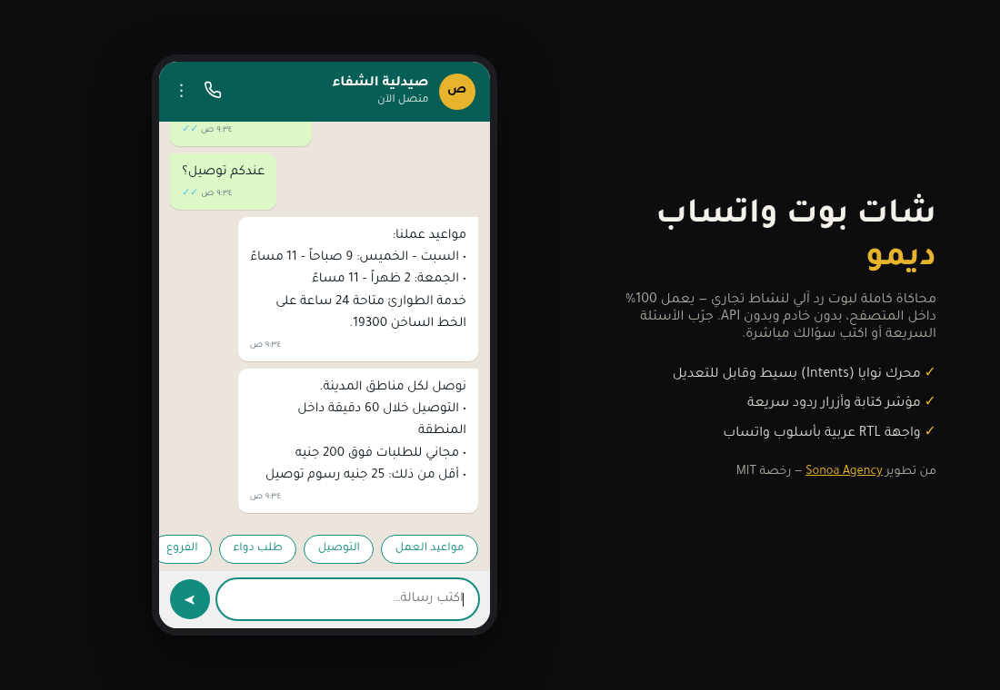

# ديمو شات بوت واتساب (WhatsApp-Style Chatbot Demo)

محاكاة كاملة لبوت رد آلي لنشاط تجاري بأسلوب محادثة واتساب — يعمل **100% داخل المتصفح**: بدون خادم، بدون API، بدون أي اعتماديات. من تطوير [Sonoa Agency](https://sonoa.online).



## المميزات

- **محرك نوايا (Intent Engine)** بسيط وواضح: كلمات مفتاحية ← رد جاهز، مكتوب بأسلوب يسهل على أي مطور تعديله.
- **تجربة واقعية**: مؤشر "يكتب الآن…"، تأخير يناسب طول الرد، وردود سريعة بأزرار.
- **واجهة عربية RTL** بتصميم واتساب المألوف — العميل يرى شكل الخدمة قبل طلبها.
- **نقطة بيع جاهزة**: مثال مبني لصيدلية، ويتحول لأي نشاط (مطعم، عيادة، متجر) بتعديل ملف واحد.

## التشغيل

افتح `index.html` في المتصفح مباشرة — لا يحتاج أي تثبيت.

## تحويله لنشاطك التجاري

كل شيء يخص المحتوى في `js/chatbot.js`:

```js
// 1) رسالة الترحيب
var BOT_WELCOME = 'أهلاً بك في …';

// 2) الردود السريعة
var QUICK_REPLIES = ['مواعيد العمل', 'التوصيل', …];

// 3) النوايا: كلمات مفتاحية ورد — أضف أو عدّل بحرية
var INTENTS = [
  { name: 'hours', keywords: ['مواعيد', 'مفتوح'], reply: 'مواعيد عملنا…' },
  …
];
```

الألوان والهوية من متغيرات `:root` في `css/style.css`.

## هيكل المشروع

```
├── index.html        # إطار الهاتف وواجهة المحادثة
├── css/style.css     # تصميم واتساب RTL
├── js/chatbot.js     # محرك النوايا والردود (كل المحتوى هنا)
└── js/app.js         # ربط المحرك بالواجهة (لا تحتاج تعديله)
```

## كيف يتحول هذا لبوت واتساب حقيقي؟

هذا الديمو يعرض تجربة المستخدم. النسخة الإنتاجية تربط نفس منطق النوايا بـ WhatsApp Business API (أو Telegram/Messenger) — تواصل معنا عبر [sonoa.online](https://sonoa.online) لتفاصيل التنفيذ.

## الرخصة

MIT — استخدمه بحرية في مشاريعك.

---

# WhatsApp-Style Chatbot Demo

A self-contained, browser-only demo of a WhatsApp-style business chatbot — no backend, no API keys, no dependencies. By [Sonoa Agency](https://sonoa.online).

- Simple intent engine (keyword match → reply), all content in `js/chatbot.js`
- Realistic UX: typing indicator, length-aware reply delay, quick-reply buttons
- Arabic RTL WhatsApp-style interface; rebrand by editing one file
- Open `index.html` to run. Licensed under MIT.
